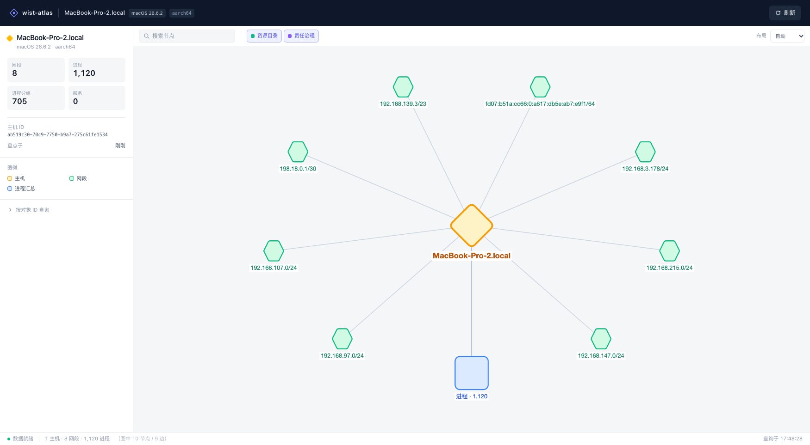
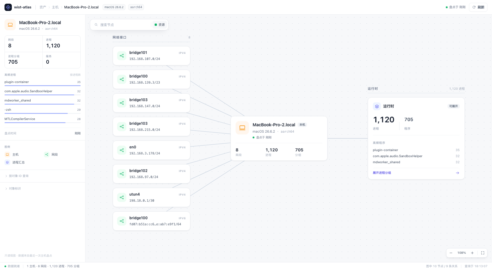
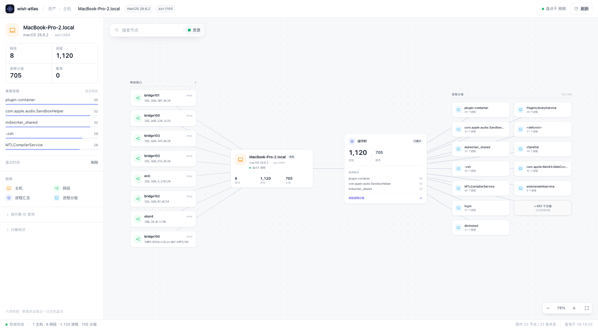
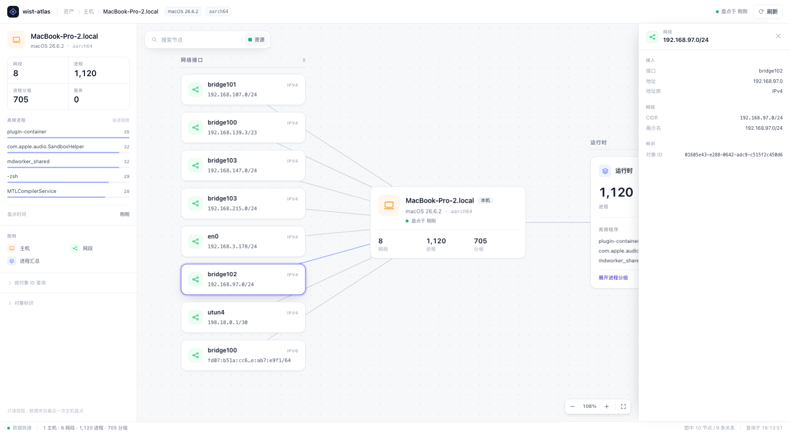
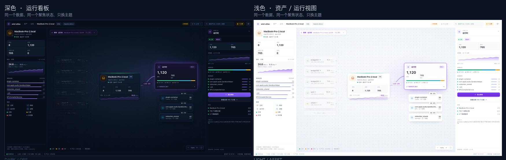
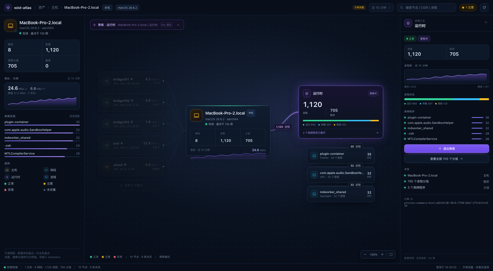
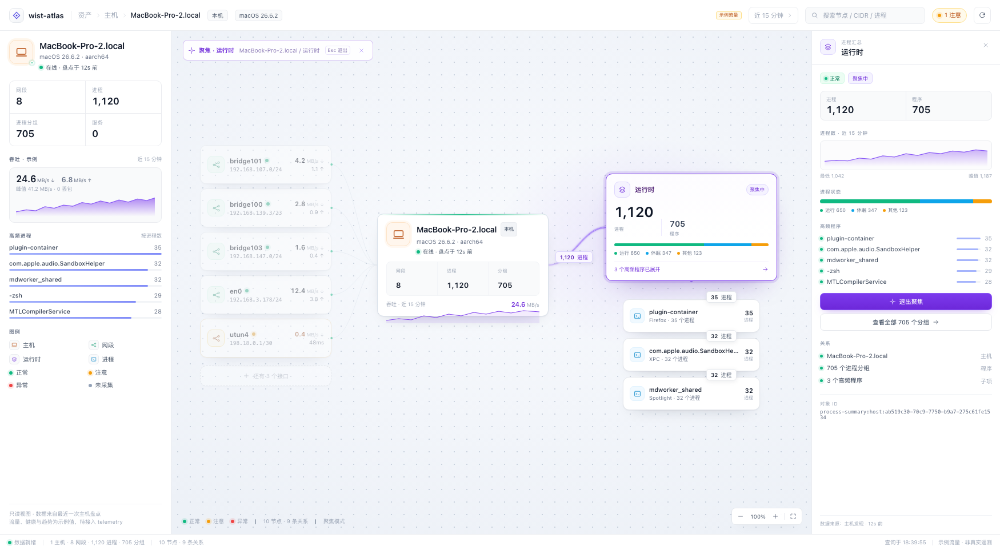

# 拓扑可视化视觉改版

> 状态：已落地到独立前端仓 `wist-atlas-web/`，`localhost:5173` 可直接看。
> 截图见本目录 [`visual/`](./visual/)。

## 1. 上一版为什么「难看」



不是配色单一处的问题，是**信息结构没有主次**：

1. **构图没有阅读方向**：一台主机 + 一圈网段摆成完美椭圆。每条边等长、方向随机，
   十个节点看起来像一个曼陀罗，用户不知道从哪儿读起。
2. **节点只是几何体**：琥珀菱形、薄荷六边形、婴儿蓝圆角矩形。形状在表达「类型」，
   但颜色太满、圆角太大，读起来像桌游棋子；节点上没有任何可读信息。
3. **标签是贴纸**：10px 灰字压在节点下方，底下还垫一块半透明白底。标签和节点没有
   结构关系，缩放后先糊成一团。
4. **最大的信息被浪费了**：接口名（`bridge102` / `en0` / `utun4`）在边的属性里，
   CIDR、地址族、进程构成都在数据里，但画布上一个都没用上。
5. **页面壳太重**：56px 深色顶栏 + 44px 白色工具条，两条横栏吃掉了 100px；
   而工具条里的「资源目录 / 责任治理」开关在只有资源对象的图上是无效的。

## 2. 借了哪些产品

| 产品 | 值得借的点 | 本项目里的落点 |
| --- | --- | --- |
| [Datadog Service Map](https://www.datadoghq.com/blog/service-map/) | 焦点节点 + 分组邻居；节点卡片带一个关键指标；搜索/聚焦时压暗无关节点 | 主机居中，网段在左、运行时在右；卡片上直接放「8 / 1,120 / 705」；搜索时非命中卡片降到 30% |
| [Grafana Node Graph](https://grafana.com/docs/grafana/latest/panels-visualizations/visualizations/node-graph/) | 画布控件克制；连线只做连接，选中/hover 才加强 | 右下角只有 − / 比例 / + / 适配；hover 时相邻边变深，其余保持安静 |
| [AWS VPC Reachability Analyzer](https://docs.aws.amazon.com/vpc/latest/reachability/what-is-reachability-analyzer.html) / 架构图 | 用「分栏 + 栏标题」表达包含与层级，而不是靠图例猜 | 「网络接口 8」「运行时 1,120 进程」「进程分组 12 / 705」三条栏标题 + 细分隔线 |
| Tailscale 管理台 | 实体档案式左栏；安静的排版；列表和详情分开 | 左栏主机档案：身份、四个规模指标、高频进程条形图；点节点看右侧抽屉 |
| Linear / Vercel 一类控制台 | 发丝边框、等宽数字、单一强调色、留白分级 | 全站唯一强调色 `#4f46e5`；数字 `tabular-nums`；`#eaecf0` 发丝线；灰阶只分三级 |

原则一句话：**把「图」从装饰变回结构，把「节点」从形状变回信息。**

## 3. 改版后的信息设计



### 3.1 从圆环改成横向剖面

```text
网络接口（左）      主机（中）        运行时（右）
bridge101          MacBook-Pro-2    1,120 进程 / 705 程序
192.168.107.0/24   macOS · aarch64  高频程序 Top 3
...                                  展开进程分组 →
```

- 左边回答「这台机器接在哪些网段上」，右边回答「这台机器里跑着什么」；
- 主机是唯一的锚点，两侧是它的两个面；
- 每个栏有标题和计数，栏标题下有一条与卡片同宽的细线，构图不再靠猜。

### 3.2 节点变成信息卡

| 类型 | 卡片内容 | 尺寸 |
| --- | --- | --- |
| 主机 | 名称 + `本机` 角标 + 系统/架构 + 盘点时间 + 网段/进程/分组 | 320×148 |
| 网段 | 接口名（来自关联边 `ifaceName`）+ CIDR（IPv6 中间截断）+ IPv4/IPv6 | 256×64 |
| 运行时 | 1,120 进程 / 705 程序 + 高频程序 + 展开动作 | 320×272 |
| 进程分组 | 可执行文件名 + 进程数 | 224×60 |
| 进程 | 状态点 + 名称 + PID | 176×44 |

颜色只出现在 28–44px 的图标块里，卡片本身是白底 + 发丝边框 + 一层很浅的阴影。
这样颜色能承担分类，又不会把画布变成糖果盘。

### 3.3 页面壳

- **一条 52px 顶栏**：产品身份 / 面包屑 / 系统与架构 / 盘点时间 / 刷新；
- **画布左上角浮动工具条**：搜索 + 图层过滤。不再占一条通栏；
- **左栏 304px 档案**：身份 → 四个指标 → 高频进程条形图 → 图例 → 对象查询/标识；
- **底部 28px 状态栏**：数据就绪、覆盖范围、图中的节点/边、查询时间。

## 4. 交互

- **hover**：卡片浮起 1px，相邻边加深；不改变其他卡片，避免画布闪。
- **选中**：卡片出现 3px 靛蓝 ring，相邻边变浅靛蓝；右侧打开详情抽屉，`Esc` 关闭。
- **搜索**：索引把边上的 `ifaceName` / `ipAddr` 并进两端节点，所以搜 `bridge`、`en0`、
  CIDR 都能命中；一条都不命中时保持全亮，只在工具条显示「无匹配」，不把画布变成幽灵。
- **展开运行时**：卡片正文 = 看详情，底部「展开进程分组」= 铺开。两个意图分开，
  不会再出现「抽屉正好盖住刚展开的分组」。
- **展开后的布局**：12 个分组按两列网格铺开（76% 缩放），而不是 dagre 排成一列
  （39% 缩放、字全糊）。





## 5. 顺手修掉的实现问题

- **点一下节点整张图重排**：`displayGraph` 每次 App 渲染都重建，画布 effect 依赖对象身份，
  选中/输入搜索都会重排 + 重新 fit。现在用结构签名（节点/边 id）做依赖，并在 App 用
  `useMemo` 稳定图对象。
- **画布高度为 0**：cytoscape 会把容器 inline `position` 改成 `relative`，原来的
  `absolute inset-0` 于是塌成 0 高，fit 只横向居中，整张图被顶到画布上沿。
  容器改成 `h-full w-full`，并用 `ResizeObserver` 在尺寸变化后重新 fit。
- **图层开关是假的**：`layerVisibility` 以前只改 state，画布没消费。现在在进 cytoscape
  之前按图层过滤节点和边。
- **浮动工具条压住栏标题**：fit 之后按栏标题的 graph 坐标计算一次上内边距，
  小于 64px 就整体下移。
- **网段搜索搜不到接口名**：新增 `utils/search.ts`，把关联边属性并进搜索索引。

## 6. 还值得继续做

1. **LOD**：节点超过 ~100 个时，低缩放级别只画图标 + 名称，避免 9px 文字。
2. **运行时钻取模式**：展开到具体进程时，把网段栏折叠成一条摘要，给进程腾出宽度。
3. **状态维度**：主机在线/离线、进程状态分布目前只有「盘点时间」，没有健康色。
4. **时间轴**：网段/接口有 `valid_from`，可以做成「这台机器最近 24h 接入了哪些网段」。
5. **Minimap / 全局鸟瞰**：图再大时需要。

## 7. 验证

```bash
cd ../wist-atlas-web
npm run lint
npm run build
```

- `localhost:5173` 已热更新；
- 截图在 1750×963 下采集，与需求里的预览尺寸一致。

## 8. 两个方向的概念图（尚未落地）

深色和浅色共用同一套布局、数据、聚焦状态，只换主题。对比图：



### 8.1 深色：运行看板



静态稿源文件：[dark-concept.html](./visual/dark-concept.html)（无依赖，可直接在浏览器打开）。

- **状态色**：主机/网段/程序用绿 / 琥珀 / 红状态点 + 卡片顶部细状态线；焦点节点用紫色描边和柔光；
- **流量数字**：节点卡片上放 `↓ 24.6 MB/s`、边上放 `1,120 进程`，时间范围固定在顶栏；
- **聚焦模式**：点「运行时」→ 只亮它和一跳邻居（主机、3 个程序），网段栏压到 25%；顶部出现聚焦路径和 `Esc 退出`，右侧抽屉显示趋势、状态分布、关系和「退出聚焦」。

深色更适合 NOC / 大屏 / 告警场景，代价是整套主题要重做，状态色和流量数字需要在暗底上重新定对比度。

### 8.2 浅色：与现有资产页同一套语言



静态稿源文件：[light-concept.html](./visual/light-concept.html)。

- **画布**：`#f2f5fa` 的浅蓝灰 + 更淡的点阵；白色卡片靠发丝线和柔和阴影浮起来；
- **状态色**：绿色/琥珀色在浅底上需要更深一档（`#059669` / `#b54708`），不能直接复用深色的亮绿/亮黄；
- **聚焦**：焦点节点不再是「紫色发光卡片」，而是白底 + 紫色描边 + 4px 柔环；网段栏压到 46%，比深色版温和，避免浅底上「一压就消失」；
- **流量**：数字颜色从 `#dbe6f5` 换成 `#101828`，单位降到 `#667085`；边上标签保持白底紫边。

浅色的优点是和现有资产页同一套视觉语言，白天办公、资产盘点场景更自然；代价是聚焦模式的戏剧性弱一些，需要靠「紫色描边 + 压暗邻居 + 聚焦栏」三件事一起表达。

### 8.3 共同的前提（比主题更重要）

两张图里的**真实数据**：主机、网段、接口名、CIDR、1,120 进程、705 分组、高频程序，
全部来自当前接口。**占位数据**：吞吐、错误率、进程状态分布、趋势线 —— 当前 read model
还没有 telemetry。要做到真数据，需要先把主机指标（CPU / 网络）或网关流量（eBPF / netflow）
接进 read model，再加字段；否则只做主题 + 聚焦、流量留空，比塞假数字安全。

状态色需要「健康状态」契约，流量需要「遥测」契约，聚焦模式需要把 `selectedNodeId`
提升成显式的 focus 状态（现在选中已经能驱动相邻边高亮，但还没有压暗非邻居）。

如果只选一个：**浅色作为默认**，深色作为「运行看板 / 大屏」的可选主题；聚焦模式两种主题共用同一个状态机，不重复实现。
